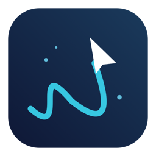
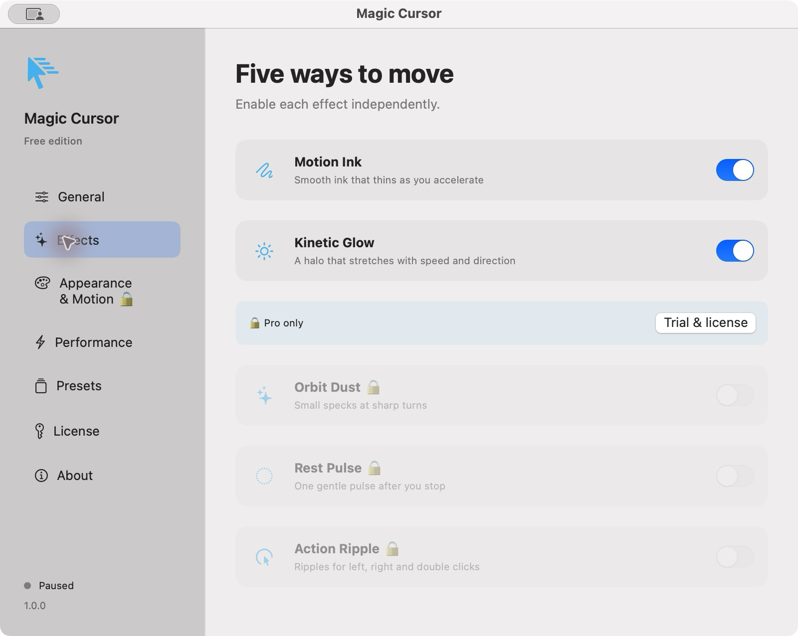

  

<h1 align="center">Magic Cursor</h1>

<strong>Motion becomes art.</strong>

Ink, light and subtle ripples that respond to the way you move.

  
  
  

  <a href="#features">Features</a> ·
  <a href="#free-and-pro">Free &amp; Pro</a> ·
  <a href="#installation">Installation</a> ·
  <a href="#usage">Usage</a> ·
  <a href="#support-and-purchasing">Support &amp; purchasing</a> ·
  <a href="#troubleshooting">Troubleshooting</a> ·
  <a href="#roadmap">Roadmap</a>

Magic Cursor is a native macOS menu bar app that adds expressive effects around your existing cursor. Smooth ink follows your path, light stretches with your speed, and small pulses respond to turns, pauses and clicks. Each effect can be switched on independently, with presets for a quick start and finer controls for a personal look.

> [!NOTE]
> **1.0.0 is available.** [Download Free from GitHub](https://github.com/LEEmj526/magic-cursor/releases/latest/download/MagicCursor-v1.0.0.dmg) or [buy Pro for $2.99 USD](https://1380489593066.gumroad.com/l/magic-cursor-pro). The Universal DMG is ad hoc signed and has not been notarized by Apple; first launch may need an extra macOS approval step. Automatic update distribution is still being prepared.

  

Actual Free edition settings window. Locked Pro controls are dimmed and marked with a lock. English and Korean interfaces are available.

## Features

### Five effects, one familiar cursor

Magic Cursor keeps the macOS pointer and draws effects around it. The overlay passes clicks through, stays out of keyboard focus and draws above ordinary app windows, including System Settings. Switch effects independently in **Settings → Effects**.

| Effect | Behavior | Tune it in Pro or Trial |
|---|---|---|
| **Motion Ink** | A smooth curve follows movement and thins as you accelerate. Old trail points fade instead of remaining on screen. | Width, lifetime, path length, smoothing and speed response. |
| **Kinetic Glow** | A soft halo stretches along your speed and direction, then settles as movement slows. | Minimum radius, maximum length and opacity. |
| **Orbit Dust** | Small specks appear when you change direction sharply. Particle count and lifetime are bounded. | Turn threshold, particles per turn, lifetime and total particle limit. |
| **Rest Pulse** | One gentle pulse appears after movement stops. It waits for movement before firing again. | Rest delay. |
| **Action Ripple** | Different ripples respond to left, right and double clicks. | Ripple duration. Click delivery depends on macOS event policies. |

### Ready-made looks

| Preset | Look | Availability |
|---|---|---|
| **Ink** | A blue ink trail without the glow. | Free, Trial, Pro |
| **Halo** | A compact glow without the ink trail. | Free, Trial, Pro |
| **Aurora** | Ink and glow with color changing by direction. | Trial, Pro |
| **Orbit** | Ink and glow, with turn particles and a rest pulse. | Trial, Pro |
| **Minimal** | A thinner, shorter ink trail. | Trial, Pro |

Presets are starting points. Changes apply immediately and save automatically. In Pro or Trial, save a custom look as a named preset and share it as a JSON file.

### Controls that fit your Mac

- **Menu bar access:** enable or pause effects, choose a preset and adjust intensity without opening the full settings window.
- **Motion controls:** custom color, Aurora color, speed sensitivity and detailed trail/glow controls.
- **Idle rendering:** animation rendering stops after trails and pulses settle. Position sampling continues to detect new movement; disabling every effect stops both sampling and rendering.
- **Power saving:** choose 30 or 60 FPS. The battery-saving option caps rendering at 30 FPS on battery or in Low Power Mode. Optional adaptive quality reduces visual detail under rendering load.
- **Display overlays:** the app creates one overlay per display. Mixed-scale and multiple physical display configurations still need broader testing.
- **Workflow controls:** launch at login, app exclusions and a global effect switch. Locking the screen or sleeping pauses input and rendering.
- **Accessibility preferences:** respect Reduce Motion; Reduce Transparency also affects overlay presentation.
- **Local preferences:** preset import/export, settings recovery and saved Pro preferences retained after a trial expires.

## Free and Pro

| Feature | Free | Pro / 3-day trial |
|---|:---:|:---:|
| Motion Ink and Kinetic Glow | Basic controls | Full controls |
| Ink and Halo presets | ✓ | ✓ |
| Orbit Dust, Rest Pulse and Action Ripple | — | ✓ |
| All five built-in presets | — | ✓ |
| Custom colors, Aurora and advanced motion settings | — | ✓ |
| Create and import custom presets | — | ✓ |
| Export the selected preset | ✓ | ✓ |
| Intensity, display overlays and battery saving | ✓ | ✓ |
| Update checks when release distribution is configured | ✓ | ✓ |

**Try Pro for 3 days (72 hours).** Open **Settings → License** and choose **Start 3-day Pro trial** when you are ready. The trial starts only when you select that button, can be started once on this Mac and does not charge a card or create a subscription. Quitting or reinstalling the app does not reset a retained Keychain trial record.

At expiry, Magic Cursor returns to Free. Your saved settings and presets stay on your Mac; a valid Pro license restores access to those settings. Version 1.0.0 uses the original saved start time for the new 72-hour window, including trials started in the earlier beta.

## Installation

**[Download Magic Cursor 1.0.0 — free DMG](https://github.com/LEEmj526/magic-cursor/releases/latest/download/MagicCursor-v1.0.0.dmg).** No Gumroad account or purchase is needed for the GitHub download. The same app supports Free, the 3-day trial and Pro; a valid license unlocks Pro without reinstalling. [Release notes and checksums](https://github.com/LEEmj526/magic-cursor/releases/latest). There is no Homebrew cask yet.

1. Download the official **MagicCursor** DMG.
2. Open it and drag **Magic Cursor** into **Applications**.
3. Launch **Magic Cursor** from Applications.
4. Select **Start experience** in the welcome window. This enables the cursor effects; it does not start the Pro trial.
5. Look for the cursor icon in the macOS menu bar. The app does not have a Dock icon.

### First launch

This release is ad hoc signed and has not been notarized by Apple, so macOS may block its first launch. If you trust the official download, first attempt to open the app, then go to **System Settings → Privacy & Security → Open Anyway** and confirm opening this specific app. Managed Macs may restrict this option. See [Apple's instructions](https://support.apple.com/en-us/102445).

Downloading through Terminal or a package manager does not sign or notarize an app. A terminal installer has not been published. Future Developer ID signed and notarized builds will simplify first launch.

## Usage

### Start with a preset

1. Open the cursor icon in the menu bar and turn on **Enable effects**.
2. Select **Ink** or **Halo**. Both work in Free.
3. Move the pointer around and adjust **Intensity**. Lower it for a more subtle look.
4. Open the gear icon or **Customize effects…** for the full settings window.
5. In **Effects**, enable only the effects you want. The three additional effects require Trial or Pro.

### Customize the motion

In **Settings → Appearance & Motion** (Trial or Pro):

| Control | What changes |
|---|---|
| Effect color / Aurora directional color | A fixed color or colors that respond to movement direction. |
| Ink width | Trail thickness, from 1 to 12 points. |
| Trail lifetime / maximum path length | How long and how far the visible trail persists. |
| Speed-responsive ink / speed sensitivity | Whether width reacts to speed and how strongly motion responds. |
| Smoothing coefficient | How quickly the velocity response follows movement; 0 disables it, 1 responds immediately. |
| Glow minimum radius / maximum length / opacity | The size, stretch and strength of the halo. |
| Turn threshold / particles per turn / particle lifetime | When turn particles appear, their count and how long they live. |
| Rest delay / click ripple duration | How long a stop waits before pulsing, and how long a click ripple lasts. |

For less visual clutter, shorten the trail, reduce intensity, or disable Orbit Dust and Action Ripple. To emphasize direction, try Aurora and increase the glow length.

### Save and share a look

1. Adjust the effect and motion controls.
2. Open **Settings → Presets**, enter a name and select **Save current** (Trial or Pro).
3. Select **Apply** next to a preset to switch looks.
4. Use **Export…** to save the selected preset as JSON. Use **Import…** to load a preset (Trial or Pro).

Changes are saved automatically. Export a preset before experimenting if you want a separate copy. You can delete custom presets from the Presets screen; built-in presets remain available.

### Battery, games and login

- Open **Settings → Performance** to select 30 or 60 FPS, enable battery saving, adapt quality to load or respect Reduce Motion.
- To pause effects in a game or another app, open **Settings → General → Add application…**, search the installed app by name and select it. **Browse…** also supports apps installed in another folder. Remove an app from the list to restore effects in it.
- Enable **Launch at login** after installing the app in Applications. macOS may require approval in System Settings.
- Choose **Language** in General for English, Korean or the system default.

### Shortcuts and license controls

| Action | Where to find it |
|---|---|
| Open settings | Menu bar gear / **Command-comma** while the app has focus |
| Pause or resume | Menu bar → **Enable effects** |
| Start the 3-day trial | **Settings → License → Start 3-day Pro trial** |
| Enter a purchased license | **Settings → License**; use the key from your Pro receipt |
| Check for updates | Menu bar / **Settings → About**; available after feed configuration |
| Quit and remove overlays | Menu bar → **Quit**, or **Command-Q** while the app has focus |

## Support and purchasing

**[Buy Magic Cursor Pro — $2.99 USD, one-time](https://1380489593066.gumroad.com/l/magic-cursor-pro?wanted=true).** In **Settings → License**, choose **Upgrade to Pro · $2.99** to go directly to Gumroad checkout. Gumroad provides a unique license key after purchase. Open **Settings → License**, paste your key and choose **Activate license**. Taxes, currency conversion and the final total appear at checkout. The app's trial does not create a subscription.

Seller test checkout, license delivery, live API verification and installer download have been checked. The distributed app rejects test keys. Activation with an actual paid purchase and a real refund remain to be verified; these checks do not constitute a real paid-purchase test.

Keep the key delivered with your order private. A purchase unlocks Pro features; downloading the installer or making an optional tip does not by itself activate a Pro license.

**[Support development](https://1380489593066.gumroad.com/l/magic-cursor-free):** the Free download accepts an optional amount above $0. Pro checkout also offers an optional tip. Support does not extend the trial or grant a Pro license; buy the separate Pro product for that. A $0 download remains available.

## Troubleshooting

<strong>I opened the app but cannot find a window.</strong>

Look for the cursor icon in the menu bar. Magic Cursor has no Dock icon. Open the menu and choose the gear icon or **Customize effects…**. Move the app into Applications before setting up launch at login.

<strong>Effects are missing or paused.</strong>

Check **Enable effects**, individual switches in **Settings → Effects**, and app exclusions in **General**. Reduce Motion, power-saving options, lock/sleep and Free permissions can change what appears. Try Ink or Halo in a normal desktop app. Protected system screens and some fullscreen games may limit overlays.

<strong>Some effects or presets are locked.</strong>

Orbit Dust, Rest Pulse, Action Ripple and advanced presets/settings require Pro or an active 3-day trial. Start the trial manually in **Settings → License**. When it expires, Free continues working and saved Pro preferences are retained.

<strong>Click ripples do not appear in another app.</strong>

Enable Action Ripple and confirm Trial or Pro access. Click delivery depends on macOS event policies; the Effects screen reports whether a global click has been received. If motion works but clicks do not, include that distinction when reporting the issue. Keyboard and screen monitoring are not used for these effects.

<strong>macOS blocks the app.</strong>

Follow the app-specific **Open Anyway** steps under Installation for the official ad hoc signed release. This release is not notarized. Do not disable system-wide security to install it. On a managed Mac, ask the administrator about the applicable app policy.

<strong>My license is rejected or the server is unavailable.</strong>

Confirm that the key belongs to Magic Cursor Pro. The app normalizes standard Gumroad keys with pasted whitespace or alternate dash characters. Seller test-purchase keys are accepted only by the separate local developer test app; the public release explains why it rejects those keys. A failed activation keeps the entered key available for retry. A temporary network failure preserves an existing saved license within its configured offline grace; a new activation needs an online verification. Refunds or disabled licenses may revoke access. Contact the seller privately with an order reference, never with a license key in a public issue.

## System requirements

| Item | Current status |
|---|---|
| Minimum deployment target | macOS 13.0 |
| Packaged architectures | Apple Silicon (`arm64`) and Intel (`x86_64`) |
| Runtime validation so far | macOS 15.8.1, Apple Silicon, one display |
| Interface languages | English, Korean and system default |

The deployment target and Universal build do not establish runtime compatibility with every Mac. Other macOS versions, Intel execution, mixed-scale displays, Spaces, Stage Manager and fullscreen applications still need testing. Protected system screens and some games may limit overlay visibility.

## Roadmap

- [x] Five motion-responsive effects and independent effect controls.
- [x] Menu bar controls, settings, presets and English/Korean interfaces.
- [x] Per-display overlays, power saving, accessibility preferences and app exclusions.
- [x] Free/Pro permissions and an explicit 3-day trial.
- [x] Keychain license storage and offline grace logic.
- [x] Sparkle integration and a Universal app/DMG build pipeline.
- [x] Configure Gumroad products, seller test checkout and installer delivery.
- [ ] Verify actual paid-purchase activation and refund/revocation.
- [ ] Complete Developer ID signing, app/DMG notarization and a real update round trip.
- [ ] Validate additional macOS versions, Intel Macs, multiple displays and long-session performance.
- [x] Publish the 1.0.0 DMG and English documentation on GitHub.

## Privacy

Magic Cursor does not collect keyboard input, screen contents or cursor-path telemetry. Cursor motion and mouse-button events are processed briefly in memory for the visual effects. Settings and presets stay on your Mac; trial and license records are stored in Keychain.

Configured license verification contacts Gumroad. Earlier development builds used Lemon Squeezy. Configured update checks and downloads contact the update feed and archive host. Automatic update checks and downloads are off by default. There is no usage analytics SDK.

## Frequently asked questions

<strong>Does this replace the macOS cursor?</strong>

No. Magic Cursor draws visual effects around the existing system cursor using transparent, nonactivating overlays designed to pass clicks through. Full manual input and focus validation is still part of release QA.

<strong>Will it keep rendering while the cursor is still?</strong>

Rendering stops once transient animations settle. Lightweight position sampling continues to detect new motion. When all effects are disabled, input sampling and rendering both stop. Long-session CPU, GPU and memory measurements are still pending.

<strong>What happens when the trial ends?</strong>

The app returns to Free. Your saved settings and presets are retained, and preset export remains available. A valid Pro license restores the saved Pro preferences.

<strong>Is the implementation source public?</strong>

No. Implementation source is kept in a private development repository. This public distribution repository contains installation files, documentation and support information. GitHub-generated source archives contain documentation only.

<strong>How do I report a problem?</strong>

Include the app version, macOS version, Mac model, display setup, selected preset and steps to reproduce. Never include license keys, passwords or payment details in a report. Global click delivery and fullscreen visibility can vary with macOS event and window policies.

## Acknowledgments

Built with **SwiftUI**, **AppKit** and **Core Animation**. Update integration uses [Sparkle](https://sparkle-project.org/), with its [license and external notices](https://github.com/sparkle-project/Sparkle/blob/2.9.4/LICENSE) included in the application. Purchase integration uses [Gumroad license keys](https://gumroad.com/help/article/76-license-keys). Earlier development builds integrated the [Lemon Squeezy License API](https://docs.lemonsqueezy.com/api/license-api).
